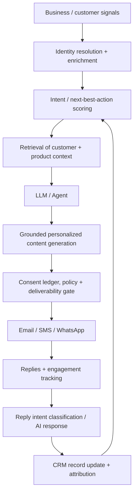

# AI-Driven Email, SMS, and WhatsApp Outreach: The Evolution of Marketing and CRM Architectures for SMBs

## Table of Contents

* Executive Summary
* Market Trends and Research Developments
* Vendor Landscape Overview
* SMB Marketing and Messaging Platforms
* AI-Native Outbound Vendors
* Dureach Deep Dive
* System Architectures and Integration Patterns
* Compliance, Deliverability, and Security
* Email
* SMS and the TCPA
* GDPR and European Electronic Marketing
* WhatsApp
* System Security and AI Privacy
* Economics, ROI, Monitoring, and Build vs. Buy
* Monitoring and Evaluation Metrics
* The Build vs. Buy Decision
* SMB Implementation Roadmap and Recommendations
* References

## Executive Summary

Between 2024 and 2026, the application of artificial intelligence in marketing and CRM expanded far beyond the elementary "write an email for me" paradigm. The emerging architectural standard is an **AI-mediated revenue loop**: collecting business/behavioral signals → resolving identity → enriching account/contact records → predicting intent or next-best-action → generating grounded personalized content → applying consent and policy guardrails → orchestrating email/SMS/WhatsApp → classifying reply intents → updating CRM records → optimizing the next action. Current offerings from platforms like Dureach, 11x, Artisan, Unify, ActiveCampaign, Brevo, and respond.io increasingly bundle multiple stages of this loop rather than providing isolated copywriting tools.

Recent academic and industry research corroborates this architectural shift. The 2024 LaMP benchmark demonstrated that personalization generation (e.g., email subject lines) benefits significantly from retrieving user-specific historical interactions rather than relying on generic prompts. A 2025–2026 study on automated marketing developed an agent architecture separating grounding, personalization, and marketing language modules. It found that the resulting copy outperformed expert-written alternatives while maintaining strict factual accuracy. Subsequently, Mercari reported a production experiment involving over one million users, wherein an LLM generated personalized marketing email titles within a pipeline that included safety, legal, brand, trust and safety, and human-in-the-loop review stages utilizing an "LLM-as-a-judge" mechanism. [1], [2], [3]

The CRMArena-Pro report by Salesforce AI Research observed that AI agents achieve approximately a 58% success rate in single-turn CRM tasks, which drops to around 35% in multi-turn scenarios. Conversely, workflow execution is highly robust, with leading agents surpassing an 83% success rate when operating within bounded workflows. The research also highlighted that agents exhibit near-zero inherent confidentiality awareness without additional constraints. This provides compelling evidence that **SMB systems should be designed around restricted workflows, trusted source retrieval, and human approval/escalation gates rather than granting LLMs unfettered access to CRMs and messaging channels.** [4] The startup ecosystem reflects rapid capitalization on this trend: 11x reportedly raised a $50M Series B in 2024 following a $24M Series A, while Artisan announced a $25M Series A in April 2025. Both position their AI agents as autonomous digital workers executing prospecting, personalized outreach, and CRM operations, rather than mere sales assistants. [5]

However, pursuing maximum AI autonomy is generally not advisable for most SMBs. The most robust deployment architecture for the near term is:

**CRM/Single Source of Truth + Customer/Behavioral Signal Layer + AI Research & Personalization + Deterministic Consent/Policy Gates + Multi-Channel Delivery Gateway + AI Reply Classification + Human Escalation + Closed-Loop Analytics.**

This architecture preserves the productivity advantages of AI while mitigating its current critical weaknesses: legal reasoning, interpreting ambiguous replies, factual grounding, data confidentiality, anomalous CRM mutations, and high-stakes business decision-making. Dureach's current design exemplifies this model: utilizing signals and data sources to enrich profiles and aid AI decision-making, enforcing strict consent/opt-out/suppression checks prior to outreach, and routing customer-facing drafts for human review.

**Dureach is particularly well-suited for SMBs conducting B2B outbound prospecting or trade-oriented customer acquisition.** It integrates a B2B data layer covering 7 million companies and 450 million contacts, trade/shipping signals, data enrichment, an embedded CRM, an AI Copilot/Deep Research agent, email/SMS/WhatsApp orchestration, smart reply drafting, deliverability controls, and API/Webhook/MCP access. Current public pricing aligns well with SMB budgets: Starter at $29/month, Growth at $79/month, Scale at $249/month, and Enterprise from $1,500/month. The Growth tier supports 25,000 contacts, 100,000 monthly sends, and Webhook access, while Scale increases capacity and adds advanced CRM and operational controls. [6]

For SMB implementation, the pragmatic approach is to deploy **AI-assisted outreach** before transitioning to fully autonomous AI agents. Enterprises should validate efficacy across one or two customer journeys before automating lower-risk reply handling and routing. B2B pilots typically commence with email due to lower marginal costs and measurable efficacy. SMS and WhatsApp should only be introduced once a unified consent management system synchronizes across the CRM and multi-channel delivery networks. Notably, WhatsApp's pricing model no longer centers on "free replies": Meta fully transitioned to per-message pricing in 2025 and, effective October 1, 2026, instituted fees for outbound service and utility messages delivered outside the standard customer service window. [7]
## Market Trends and Research Developments

The most significant technological paradigm shift between 2024 and 2026 is the transition from **content generation to process orchestration**.

Early generative marketing systems relied on basic prompts requesting LLMs to output subject lines, ad copy, or email bodies. The new generation fully integrates retrieval, signal triggering, agentic planning, tool invocation, and feedback loops:

The LaMP benchmark provides a critical academic foundation for the "Retrieval" component of this architecture. Evaluating personalized email subject generation, it demonstrated that retrieval-augmented generation utilizing user-specific historical interactions significantly outperforms indiscriminately dumping entire CRM records into a prompt. This supports a broader design principle: personalization must rely on retrieving relevant behavioral and contextual exemplars rather than unconstrained data ingestion. [1]

Further research into automated marketing proposes a highly portable outreach model for SMBs. Rather than allowing the model to autonomously determine "what the facts are" and "how to pitch them," the architecture strictly decouples **grounding**, **personalization**, and **marketing language generation**: it extracts deterministic factual claims from approved product, customer, and account records, subsequently delegating the rhetorical framing of those claims to the language model. [2]

Mercari's engineering implementation is highly instructive, as a real-world deployed production application rather than a benchmark. Their architecture encompasses item recommendation, context engineering, sensitive word filtering, LLM title generation, and an LLM-as-a-judge evaluation mechanism, establishing human-in-the-loop nodes across trust and safety, marketing, brand/UX, legal, InfoSec, IP, and AI ethics. The experiment spanned over a million users, providing a canonical example that generative marketing in production must be engineered as a **rigorous quality control pipeline**, not merely a solitary API call. [3]

The second major shift is the move from static demographic targeting to **signal-driven intent recognition**. Current systems capture website telemetry, corporate funding events, personnel changes, CRM stage progressions, historical dialog, product telemetry, and (in Dureach's case) global trade and logistics data to determine *who to contact right now and the optimal angle for engagement*. Dureach details a "signal → identity matching → enrichment → outreach" workflow; Unify leverages job changes, hiring data, and web/product intent signals; Artisan emphasizes real-time contextual triggers based on job transitions, funding, and executive changes. [8]

The third evolution is **AI assumption of the "Return Path."** Products increasingly handle post-send operations—classifying replies, answering routine inquiries, booking meetings, and updating CRM records—rather than ceasing function after message generation. Artisan markets autonomous reply handling and meeting booking; 11x's digital worker "Alice" processes outbound replies, while its inbound counterpart handles SMS, WhatsApp, and phone inquiries; Dureach's AI Reply Agent drafts context-aware responses for human approval; respond.io tightly bundles AI agents with its omnichannel workflow. [9]

The fourth advancement is the proliferation of **agent-facing integration protocols**, notably the Model Context Protocol (MCP), alongside traditional APIs and Webhooks. Dureach supports OAuth-secured MCP connections; Brevo advertises MCP integration for AI clients like ChatGPT and Claude; Bird deeply integrates MCP within its developer toolset. This is a critical development, enabling AI clients to discover and invoke authorized business tools systematically, eliminating the need for every enterprise to write custom LLM plugins. However, this **does not** negate the strict necessity for least-privilege principles, audit logging, and human approval gates. [10]

Consequently, the current market bifurcates into several core categories:

| Category | Representative Products | Core Advantages | Primary Limitations for SMBs |
| --- | --- | --- | --- |
| CRM-Centric Marketing Automation | HubSpot, ActiveCampaign | Native CRM environment; robust lifecycle journey orchestration | Costs escalate significantly at advanced tiers |
| SMB Omnichannel Suites | Dureach, Brevo | Low barrier to entry; multiple functions bundled within a single system | May lack functional depth in highly specialized single channels |
| Commerce CRM | Klaviyo | Extremely deep eCommerce profiling, segmentation, and revenue attribution | Designed for B2C/eCommerce lifecycle marketing; unsuitable for broad B2B cold prospecting |
| WhatsApp / Customer Conversation Platforms | Wati, respond.io, SleekFlow | Superior message handling, shared inboxes, workflow automation, and AI reply assistance | Channel costs (plus Meta's communication fees) stack on top of base platform subscriptions |
| Communications Platform as a Service (CPaaS) | Bird and similar providers | API-first; high composability; granular low-level channel control | Demands significantly higher R&D and implementation investment |
| AI-Native SDR / GTM Agents | 11x, Artisan, AiSDR, Unify | Executes a single agentic loop from research → personalization → outreach → reply follow-up | Demands rigorous human control over agent autonomy, data quality, and compliance governance |

This classification synthesizes the current product models published by vendors. [11]

It is necessary to apply a pragmatic reality check to market exuberance. While SMB AI adoption is objectively high, most published evidence stems from vendor-sponsored surveys. A Salesforce survey of 3,350 SMB leaders indicated that 75% are at least experimenting with AI; among current users, 91% reported that AI increased revenue. While these are useful indicators of adoption and perceived value, they should not be conflated with peer-reviewed causal evidence of AI-driven revenue lift. [12]
