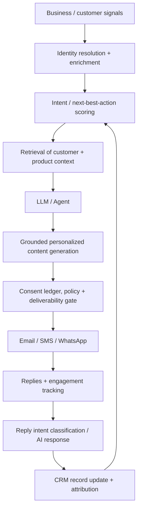
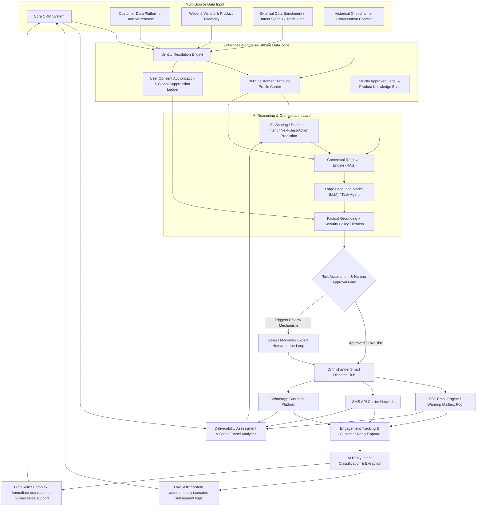
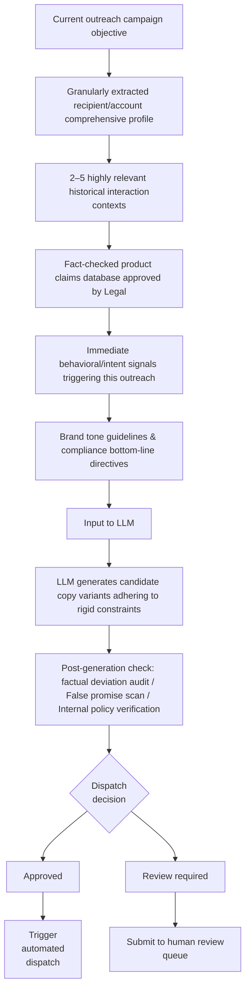

# AI-Driven Email, SMS, and WhatsApp Outreach: The Evolution of Marketing and CRM Architectures for SMBs

## Table of Contents

* Executive Summary
* Market Trends and Research Developments
* Vendor Landscape Overview
* SMB Marketing and Messaging Platforms
* AI-Native Outbound Vendors
* Dureach Deep Dive
* System Architectures and Integration Patterns
* Compliance, Deliverability, and Security
* Email
* SMS and the TCPA
* GDPR and European Electronic Marketing
* WhatsApp
* System Security and AI Privacy
* Economics, ROI, Monitoring, and Build vs. Buy
* Monitoring and Evaluation Metrics
* The Build vs. Buy Decision
* SMB Implementation Roadmap and Recommendations
* References

## Executive Summary

Between 2024 and 2026, the application of artificial intelligence in marketing and CRM expanded far beyond the elementary "write an email for me" paradigm. The emerging architectural standard is an **AI-mediated revenue loop**: collecting business/behavioral signals → resolving identity → enriching account/contact records → predicting intent or next-best-action → generating grounded personalized content → applying consent and policy guardrails → orchestrating email/SMS/WhatsApp → classifying reply intents → updating CRM records → optimizing the next action. Current offerings from platforms like Dureach, 11x, Artisan, Unify, ActiveCampaign, Brevo, and respond.io increasingly bundle multiple stages of this loop rather than providing isolated copywriting tools.

Recent academic and industry research corroborates this architectural shift. The 2024 LaMP benchmark demonstrated that personalization generation (e.g., email subject lines) benefits significantly from retrieving user-specific historical interactions rather than relying on generic prompts. A 2025–2026 study on automated marketing developed an agent architecture separating grounding, personalization, and marketing language modules. It found that the resulting copy outperformed expert-written alternatives while maintaining strict factual accuracy. Subsequently, Mercari reported a production experiment involving over one million users, wherein an LLM generated personalized marketing email titles within a pipeline that included safety, legal, brand, trust and safety, and human-in-the-loop review stages utilizing an "LLM-as-a-judge" mechanism. [1], [2], [3]

The CRMArena-Pro report by Salesforce AI Research observed that AI agents achieve approximately a 58% success rate in single-turn CRM tasks, which drops to around 35% in multi-turn scenarios. Conversely, workflow execution is highly robust, with leading agents surpassing an 83% success rate when operating within bounded workflows. The research also highlighted that agents exhibit near-zero inherent confidentiality awareness without additional constraints. This provides compelling evidence that **SMB systems should be designed around restricted workflows, trusted source retrieval, and human approval/escalation gates rather than granting LLMs unfettered access to CRMs and messaging channels.** [4] The startup ecosystem reflects rapid capitalization on this trend: 11x reportedly raised a $50M Series B in 2024 following a $24M Series A, while Artisan announced a $25M Series A in April 2025. Both position their AI agents as autonomous digital workers executing prospecting, personalized outreach, and CRM operations, rather than mere sales assistants. [5]

However, pursuing maximum AI autonomy is generally not advisable for most SMBs. The most robust deployment architecture for the near term is:

**CRM/Single Source of Truth + Customer/Behavioral Signal Layer + AI Research & Personalization + Deterministic Consent/Policy Gates + Multi-Channel Delivery Gateway + AI Reply Classification + Human Escalation + Closed-Loop Analytics.**

This architecture preserves the productivity advantages of AI while mitigating its current critical weaknesses: legal reasoning, interpreting ambiguous replies, factual grounding, data confidentiality, anomalous CRM mutations, and high-stakes business decision-making. Dureach's current design exemplifies this model: utilizing signals and data sources to enrich profiles and aid AI decision-making, enforcing strict consent/opt-out/suppression checks prior to outreach, and routing customer-facing drafts for human review.

**Dureach is particularly well-suited for SMBs conducting B2B outbound prospecting or trade-oriented customer acquisition.** It integrates a B2B data layer covering 7 million companies and 450 million contacts, trade/shipping signals, data enrichment, an embedded CRM, an AI Copilot/Deep Research agent, email/SMS/WhatsApp orchestration, smart reply drafting, deliverability controls, and API/Webhook/MCP access. Current public pricing aligns well with SMB budgets: Starter at $29/month, Growth at $79/month, Scale at $249/month, and Enterprise from $1,500/month. The Growth tier supports 25,000 contacts, 100,000 monthly sends, and Webhook access, while Scale increases capacity and adds advanced CRM and operational controls. [6]

For SMB implementation, the pragmatic approach is to deploy **AI-assisted outreach** before transitioning to fully autonomous AI agents. Enterprises should validate efficacy across one or two customer journeys before automating lower-risk reply handling and routing. B2B pilots typically commence with email due to lower marginal costs and measurable efficacy. SMS and WhatsApp should only be introduced once a unified consent management system synchronizes across the CRM and multi-channel delivery networks. Notably, WhatsApp's pricing model no longer centers on "free replies": Meta fully transitioned to per-message pricing in 2025 and, effective October 1, 2026, instituted fees for outbound service and utility messages delivered outside the standard customer service window. [7]
## Market Trends and Research Developments

The most significant technological paradigm shift between 2024 and 2026 is the transition from **content generation to process orchestration**.

Early generative marketing systems relied on basic prompts requesting LLMs to output subject lines, ad copy, or email bodies. The new generation fully integrates retrieval, signal triggering, agentic planning, tool invocation, and feedback loops:

The LaMP benchmark provides a critical academic foundation for the "Retrieval" component of this architecture. Evaluating personalized email subject generation, it demonstrated that retrieval-augmented generation utilizing user-specific historical interactions significantly outperforms indiscriminately dumping entire CRM records into a prompt. This supports a broader design principle: personalization must rely on retrieving relevant behavioral and contextual exemplars rather than unconstrained data ingestion. [1]

Further research into automated marketing proposes a highly portable outreach model for SMBs. Rather than allowing the model to autonomously determine "what the facts are" and "how to pitch them," the architecture strictly decouples **grounding**, **personalization**, and **marketing language generation**: it extracts deterministic factual claims from approved product, customer, and account records, subsequently delegating the rhetorical framing of those claims to the language model. [2]

Mercari's engineering implementation is highly instructive, as a real-world deployed production application rather than a benchmark. Their architecture encompasses item recommendation, context engineering, sensitive word filtering, LLM title generation, and an LLM-as-a-judge evaluation mechanism, establishing human-in-the-loop nodes across trust and safety, marketing, brand/UX, legal, InfoSec, IP, and AI ethics. The experiment spanned over a million users, providing a canonical example that generative marketing in production must be engineered as a **rigorous quality control pipeline**, not merely a solitary API call. [3]

The second major shift is the move from static demographic targeting to **signal-driven intent recognition**. Current systems capture website telemetry, corporate funding events, personnel changes, CRM stage progressions, historical dialog, product telemetry, and (in Dureach's case) global trade and logistics data to determine *who to contact right now and the optimal angle for engagement*. Dureach details a "signal → identity matching → enrichment → outreach" workflow; Unify leverages job changes, hiring data, and web/product intent signals; Artisan emphasizes real-time contextual triggers based on job transitions, funding, and executive changes. [8]

The third evolution is **AI assumption of the "Return Path."** Products increasingly handle post-send operations—classifying replies, answering routine inquiries, booking meetings, and updating CRM records—rather than ceasing function after message generation. Artisan markets autonomous reply handling and meeting booking; 11x's digital worker "Alice" processes outbound replies, while its inbound counterpart handles SMS, WhatsApp, and phone inquiries; Dureach's AI Reply Agent drafts context-aware responses for human approval; respond.io tightly bundles AI agents with its omnichannel workflow. [9]

The fourth advancement is the proliferation of **agent-facing integration protocols**, notably the Model Context Protocol (MCP), alongside traditional APIs and Webhooks. Dureach supports OAuth-secured MCP connections; Brevo advertises MCP integration for AI clients like ChatGPT and Claude; Bird deeply integrates MCP within its developer toolset. This is a critical development, enabling AI clients to discover and invoke authorized business tools systematically, eliminating the need for every enterprise to write custom LLM plugins. However, this **does not** negate the strict necessity for least-privilege principles, audit logging, and human approval gates. [10]

Consequently, the current market bifurcates into several core categories:

| Category | Representative Products | Core Advantages | Primary Limitations for SMBs |
| --- | --- | --- | --- |
| CRM-Centric Marketing Automation | HubSpot, ActiveCampaign | Native CRM environment; robust lifecycle journey orchestration | Costs escalate significantly at advanced tiers |
| SMB Omnichannel Suites | Dureach, Brevo | Low barrier to entry; multiple functions bundled within a single system | May lack functional depth in highly specialized single channels |
| Commerce CRM | Klaviyo | Extremely deep eCommerce profiling, segmentation, and revenue attribution | Designed for B2C/eCommerce lifecycle marketing; unsuitable for broad B2B cold prospecting |
| WhatsApp / Customer Conversation Platforms | Wati, respond.io, SleekFlow | Superior message handling, shared inboxes, workflow automation, and AI reply assistance | Channel costs (plus Meta's communication fees) stack on top of base platform subscriptions |
| Communications Platform as a Service (CPaaS) | Bird and similar providers | API-first; high composability; granular low-level channel control | Demands significantly higher R&D and implementation investment |
| AI-Native SDR / GTM Agents | 11x, Artisan, AiSDR, Unify | Executes a single agentic loop from research → personalization → outreach → reply follow-up | Demands rigorous human control over agent autonomy, data quality, and compliance governance |

This classification synthesizes the current product models published by vendors. [11]

It is necessary to apply a pragmatic reality check to market exuberance. While SMB AI adoption is objectively high, most published evidence stems from vendor-sponsored surveys. A Salesforce survey of 3,350 SMB leaders indicated that 75% are at least experimenting with AI; among current users, 91% reported that AI increased revenue. While these are useful indicators of adoption and perceived value, they should not be conflated with peer-reviewed causal evidence of AI-driven revenue lift. [12]
## Vendor Landscape Overview

### SMB Marketing and Messaging Platforms

Pricing reflects publicly available base rates as of October 2026; actual Total Cost of Ownership (TCO) will vary drastically based on contact volume, send volume, annual billing discounts, onboarding fees, carrier SMS fees, and Meta messaging fees.

| Vendor | Core Channels & Primary Use Case | Key AI & Data Capabilities | Integration Ecosystem | Public Pricing Overview |
| --- | --- | --- | --- | --- |
| **Dureach** | Email, SMS, WhatsApp; B2B GTM & CRM | Deep research, Copilot, AI Agents, reply drafting, intent signals, data enrichment, B2B trade/logistics data, deliverability monitoring | Built-in CRM, mailbox integration, API/Webhooks, MCP/OAuth; external CRM sync | **Starter $29/mo; Growth $79/mo; Scale $249/mo; Enterprise from $1,500/mo.** |
| **ActiveCampaign** | Email-centric lifecycle automation (with SMS/WhatsApp) | Active Intelligence, AI content generation, advanced segmentation, predictive sending, dynamic content | Native CRM and eCommerce integrations; SMS as add-on; WhatsApp + Email bundles | **Starter from $15/mo; Plus $49; Pro $79; Enterprise from $145** (annual billing). |
| **Brevo** | Email, SMS, WhatsApp, sales conversation orchestration | AI copywriting, Aura send-time optimization, audience segmentation, AI conversational assistant | API/Webhooks, sales tool integrations, MCP connection | Free tier available; **Starter from $9/mo; Standard from $18/mo; Professional from $499/mo**; Enterprise custom. |
| **HubSpot Marketing Hub** | Closed-loop marketing hub built around core CRM | Breeze/AI toolset, workflow automation, advanced segmentation, lead scoring, cross-platform agents | Industry-leading native CRM experience and massive app integration ecosystem | Free/Starter available; Current guide pricing: **Pro ~$800/mo (+$3,000 onboarding); Enterprise ~$3,600/mo (+$7,000 onboarding).** |
| **Klaviyo** | Commerce email/SMS lifecycle management | AI subject generation, predictive segmentation, workflow orchestration, attribution analytics, AI Composer | Benchmark-level eCommerce (e.g., Shopify) and data infrastructure integrations | Free tier includes **250 active profiles/500 emails per month** (Mobile messaging +$5, AI Composer +$5); Paid plans strictly usage-tiered. |
| **Wati** | WhatsApp-centric sales, support, and marketing | AI Copilot reply assistance, message automation trees, team shared inbox | WhatsApp Business API, eCommerce plugins, basic channel integrations | Growth plan equates to **$59/mo** (annual billing); 1,000 AI Copilot credits cost $30; Meta communication fees separate. |
| **respond.io** | B2C omnichannel conversation management & AI agents | AI agent replies, prompt assistance, omnichannel workflows, voice/call AI features | Aggregates WhatsApp, social media, email; provides Webhooks/APIs | Annual billing equivalents: **Starter $79; Growth $159; Advanced $279**; Monthly billing is higher. |
| **SleekFlow** | Omnichannel conversational commerce & engagement | AI inbox Copilot, customer service agents, lifecycle tagging | Unifies WhatsApp/SMS/Email/Voice, Shopify, Zapier/Make; advanced tiers support deep CRM sync | U.S. Essential plan annual billing equates to **$49/mo**; communication channel usage billed independently. |
| **Bird** | Developer-centric & API-first Email/SMS/WhatsApp infrastructure | Highly stable foundational communication infrastructure and developer tools (including MCP) | Native APIs, SDKs, CLI, MCP | Email services from **$15/mo**; U.S. SMS reference **$0.0035/segment + carrier fees**; U.S. WhatsApp marketing message processing **$0.005/message + Meta fees.** |

### AI-Native Outbound Vendors

| Vendor | Core Agent Responsibilities | Signal Sources & Integrations | Pricing Observations |
| --- | --- | --- | --- |
| **Artisan / Alice** | Lead discovery, deep research, personalization, campaign execution, autonomous reply handling, meeting booking | Claims 250M+ B2B contact database; bidirectional HubSpot/Salesforce sync, Webhooks, Slack; built-in content guardrails and approval flows | Current core public pricing falls roughly in the **$2,500 to $6,000 per month** range for sales-led outreach volume tiers; Enterprise custom. Emphasizes SOC 2 Type II, SSO/SAML, and audit logs. [9] |
| **11x / Alice** | End-to-end Outbound execution; research, scheduling, follow-up, and meeting invites; Inbound agent supports SMS/WhatsApp | Treats CRM as the single source of truth; integrates Salesforce, HubSpot, Slack, API/Webhooks; merges web and engagement signals | Sales-led pricing. Current documentation heavily promotes autonomous "Digital Worker" execution via email, voice, LinkedIn, SMS, and WhatsApp. |
| **AiSDR / Amie** | Automated background research, target filtering, cold email drafting, and iterative follow-up | Combines existing CRM with proprietary domain/mailbox/LinkedIn scraping capabilities | **$250/user/month**, including deep AI research for 200 contacts, 1 domain, and 3 mailboxes. Vendor claims most clients see ROI within 30-60 days (treat as marketing claim, not industry benchmark). |
| **Unify** | AI outbound engine, data enrichment, intent-signal-triggered workflows, highly personalized email generation | Claims 40+ integrated data sources; covers job changes, hiring signals, web/product intent; HubSpot/Salesforce sync, Slack, API/Webhooks | Free tier available; **Basic $20/seat/mo; Pro $60/seat/mo; Business custom.** Business adds managed mailbox pools, warmup/rotation, and deep read/write CRM sync. |

**SMBs must not evaluate these platforms solely on "copywriting generation quality."** Procuring an AI SDR tool intrinsically means selecting a **data provider, a strategic decision engine, a copywriter, a sending infrastructure, a reply intent classifier, and effectively a secondary CRM administrator.** A critical failure in any single node—such as identity resolution errors, unauthorized outreach, damaged sending domain reputation, hallucinated "personalization," or misclassified replies—will instantly negate the advantages of the entire system.

### Dureach Deep Dive

Dureach's current product positioning is most accurately described as a **"Signal-to-Pipeline GTM Operations Hub,"** rather than a rudimentary mass-email automation tool. Its published system architecture extracts leads from massive trade/freight records, social dynamics, news, corporate directories, websites, documents, historical CRM interactions, and customer replies. It then constructs multidimensional profiles of companies and decision-makers, ensuring data provenance and authorized usage. The system fluidly connects background research, priority lead scoring, omnichannel execution, and CRM handoff. Currently, Dureach claims its underlying data network covers over 7 million global enterprises and 450 million B2B contacts.

| Dureach Core Capability Area | Currently Released Features | Researcher Evaluation |
| --- | --- | --- |
| **Artificial Intelligence (AI)** | Copilot, Deep Research, orchestratable agents, dedicated AI tools for PDF/website/script parsing, AI reply assistant, MCP connection | Highly attractive for "deep-research-driven B2B prospecting." The AI layer is deeply coupled with the underlying data/signal network, eliminating the need to procure expensive external data feeds independently. |
| **Data Foundation & Intent Signals** | In-depth company/contact directories, trade & export/import freight records, website visitor resolution, high-priority buying intent signals | **Trade and freight records act as a primary competitive differentiator**, granting the platform an unmatched advantage in import/export, advanced manufacturing, logistics, supply chain, and cross-border B2B scenarios. |
| **Email Engine** | Campaign orchestration, mailbox routing and warmup, Inbox Placement monitoring, spam score prediction, dynamic deliverability controls | Dureach discloses fully automated A/B split testing and AI-triggered pause/re-warmup mechanisms; the Enterprise tier adds dedicated SISR servers/IP sharding and rotation scheduling. [13] |
| **SMS & WhatsApp** | Orchestrates cross-channel marketing and follow-ups strictly contingent upon official channel compliance and user consent | Functions excellently as a unified cross-channel dispatcher; however, Meta's and telecom carriers' compliance audits and per-message billing rules remain independently enforced, outside of Dureach's control. |
| **Native CRM System** | Lightweight native CRM integrating lead routing, customer replies, follow-up notes, ownership attribution, and opportunity tracking | Sufficient to save smaller outbound sales teams the significant expense of procuring an independent standalone CRM. |
| **External CRM Integration** | Official "Visitor Data Operational Guide" covers integration with HubSpot, Salesforce, and Pipedrive; supports Zapier/iPaaS expansion flows | In practical evaluation, robust workflow orchestration holds more value than a list of "native plugin" icons. Buyers should rigorously verify if the CRM connector supports specific business object syncing before signing. |
| **Developer & Systems Integration** | Provides OAuth-secured APIs, real-time Webhooks, and deep support for the MCP protocol | A highly forward-looking core capability for technical teams aiming to build advanced AI-native RevOps closed-loop architectures in 2026. |
| **Compliance & Data Governance** | Unified global consent management, one-click opt-out, global suppression lists; introduces foundational concepts of "traceable source provenance" and "compliant authorized use" | Architecturally sound and progressive. During implementation, buyers must independently verify contractual data usage rights, model sub-processor clauses, data retention/destruction agreements, and InfoSec certifications with legal counsel. |

The current pricing structure is exceptionally transparent and accessible:

| Subscription Plan | Pricing Standard | Core Capacity Constraints & Positioning |
| --- | --- | --- |
| **Starter** | **$29/mo (or $290/year)** | Supports 1,000 contacts, 5,000 monthly sends, Basic CRM, 7-day free trial. |
| **Growth** | **$79/mo (or $790/year)** | Supports 25,000 contacts, 100,000 monthly sends, Basic CRM, unlocks Webhook access; **Positioned by Dureach as the "default optimal choice" for most small GTM teams.** |
| **Scale** | **$249/mo (or $2,490/year)** | Capacity leaps to 100,000 contacts, 500,000 monthly sends, upgrades to Pro CRM, and unlocks advanced system operations and deep deliverability controls. |
| **Enterprise** | **From $1,500/mo** | Designed for customized volume; includes deep contractual SLAs, advanced security/compliance governance, API/raw data access rights, and tailored InfoSec audits. |

*Note: The "annual billing" discount for self-serve tiers (Starter/Growth/Scale) is substantial, essentially equating to two free months. Basic trade data discovery is included in standard self-serve plans; however, massive data exports, high-volume API calls, deep penetration into specific regional markets, or broader commercial trade data usage rights likely require purchasing add-ons or upgrading to Enterprise terms.* [6]
## System Architectures and Integration Patterns

For the vast majority of SMBs, there are three pragmatic architectural choices:

| Architecture Model | System Characteristics | Core Advantages | Potential Disadvantages | Best Suited For |
| --- | --- | --- | --- | --- |
| **All-in-One Cloud SaaS Suite** | CRM + Marketing Automation + AI + Delivery channels fully integrated within a single platform (e.g., HubSpot, Brevo, ActiveCampaign, Dureach) | Extremely fast implementation; near-zero IT/DevOps burden; unified data model | Vendor lock-in risk; less control over underlying LLMs and data flows | Most startups and small-to-medium businesses |
| **Composable / Hybrid Cloud Architecture** | CRM/CDP remains the absolute System of Record (SoR); AI orchestration layer and messaging gateways are decoupled as independent microservices | Freedom to assemble best-of-breed tools; lower vendor switching costs; absolute control over core data assets | High system integration complexity; demands rigorous full-stack observability | Scaling mid-market SMBs with specific data routing requirements |
| **Private / Hybrid AI Architecture** | Highly sensitive CRM/Data Warehouse strictly controlled within enterprise private cloud; data is redacted and only minimal context is sent to AI models; multi-channel sending relies entirely on internally managed compliance gateways | Maximum ceiling for privacy, security, and compliance; flexibility to swap underlying LLMs | Prohibitively high R&D engineering costs and continuous governance burden | Enterprises bound by strict financial/healthcare regulations or those treating data as their primary asset |

In the commercial SMB product sector, **managed SaaS is overwhelmingly the default standard; true on-premise deployments are exceedingly rare.** Therefore, a pragmatic "hybrid" system design usually means: the enterprise locks core customer data, consent status, data warehouses, and the policy orchestration layer within a tightly controlled private environment, while still relying on standard APIs to call external ESPs, telecom carriers, and Meta/WhatsApp infrastructure for final message delivery. This represents a macro-architectural philosophy synthesized from current market best practices, not a claim that any single vendor provides this exact setup out-of-the-box.

A robust, fault-tolerant **Composable Architecture** design is structured as follows:

The most critical "moat" in this design is establishing a **Consent and Policy Ledger that possesses absolute veto power, entirely independent of the LLM.** The LLM can freely exercise its reasoning to recommend the most efficient channel, draft stunning copy, or map out the next strategic move; however, the final authorization to "send" must mandatorily query a database of deterministic fields. These fields must include: jurisdictional regulations, source of user consent, timestamps, authorized use cases, approved channels, opt-out status, suppression reasons, and the specific category of the marketing campaign. **Never design a system that asks an LLM, "Is it legal to send an SMS to this user?"—compliance is not a probabilistic determination.**

Identity Resolution is equally a matter of systemic survival. A robust customer profile architecture must enforce hierarchical decoupling:

`Physical Person ID (person_id) → Associated Account/Company ID (account_id) → Linked Email Identities → Linked Phone/WhatsApp Identities → Consent Authorization Ledger for this entity → Historical Behavioral Event Stream → CRM Opportunities.`

Lacking this rigorous decoupling, if a customer uses an alternate email, changes employers, or appears as a duplicate record in external enrichment feeds, the global "Opt-out" logic and the funnel "Attribution" chain will instantly collapse, triggering catastrophic compliance breach risks.

At the content generation layer, the most reliable personalization engineering approach is **Retrieval-Augmented Generation (RAG)**:

This perfectly mirrors the LaMP benchmark's conclusion that "retrieval drastically improves personalization quality," while strongly aligning with automated marketing academic research emphasizing that "factual grounding must be physically isolated from persuasive language generation mechanisms." [1], [2]

Regarding **Intent Prediction**, SMBs generally do not need to burn capital training massive, opaque deep learning models. A weighted scoring formula blending Ideal Customer Profile (ICP) fit with recent behavioral trajectories is typically highly efficient and controllable:

  
<strong>Comprehensive Intent Score</strong> =

  <ol>
    <li>w1ICP Fit</li>
    <li>w2Website &amp; Product Engagement Activity</li>
    <li>w3Recency of Action</li>
    <li>w4Historical Communication Engagement</li>
    <li>w5External Intent Signals (e.g., Funding or Hiring)</li>
  </ol>

Building upon this, an LLM can utilize its natural language understanding to explain the score in human terms or extract high-value highlight information. However, the deterministic (or ML-based) scoring system must maintain its independence and quantifiability. This architectural choice prevents underlying foundation models from silently altering the core business logic of "who qualifies to be contacted" during unseen version updates.

For Response Automation, it is imperative to adopt a rigorous, **risk-degraded tiered handling strategy**:

  
<strong>Reply "Unsubscribe/STOP"</strong>Immediately triggers system-level deterministic global suppression

  
<strong>Reply "Wrong person/Bounced"</strong>Triggers deterministic invalid data hygiene &amp; status update

  
<strong>Reply requests "Book a Demo"</strong>Automatically invokes seamless calendar scheduling workflow

  
<strong>Inquires about "Standard FAQs"</strong>AI drafts grounded response or auto-replies with strictly bounded standard scripts

  
<strong>Inquires about "Pricing/Legal"</strong>Immediate interception &amp; handover to human sales/legal team

  
<strong>Sends a "Legal warning/Complaint"</strong>Highest priority alert &amp; handover to human executive intervention

  
<strong>Expresses "Highly sensitive emotion"</strong>Intercept &amp; handover to human support lead for de-escalation

  
<strong>Reply content is "Ambiguous"</strong>Handover to human agent for manual interpretation

This represents the safest and most reliable paradigm for introducing AI into production environments today. As revealed by the CRMArena-Pro study, allowing AI to execute bounded, single-purpose workflows is vastly more reliable than permitting large models to engage in unconstrained, multi-turn complex CRM reasoning. [4]

The following four typical technology stack matrices cover the vast majority of SMB commercial scenarios:

| Business Scenario | Recommended Tech Stack Selection | Core Rationale |
| --- | --- | --- |
| **Lean Lifecycle Marketing Automation** | ActiveCampaign or Brevo → Native automation workflow engine → Lightweight built-in CRM → Closed-loop analytics dashboard | Extremely low monthly subscription costs requiring zero technical DevOps intervention; ideal as an enterprise's first foray into AI marketing. |
| **Aggressive B2B Sales-Led / Heavy Prospecting** | Dureach Growth/Scale plan → Native Dureach CRM (or bidirectional sync with HubSpot/Pipedrive) → Webhook pushes → Slack real-time alerts & BI attribution | Seamlessly integrates external intent signal capture, lead enrichment, deep research, AI strategic planning, and multi-channel outreach execution within a highly fluid operational interface. |
| **SMBs Heavily Dependent on WhatsApp** | Wati or respond.io → Core CRM system → Meta WhatsApp official platform → SMS (as a fallback degradation route) → Built-in automation trees or iPaaS expansion | Delivers exceptionally powerful multi-team shared inboxes and conversation automation flows optimized specifically for high-frequency chat scenarios. |
| **Highly Composable Systems Prioritizing Data Sovereignty & Flexibility** | Core CRM + Postgres/Cloud Data Warehouse foundation → "Compliance Status Microservice" strictly controlled by the enterprise → Internal RAG architecture/Vector DB → Enterprise-exclusive private or managed LLM nodes → Communication engines like Bird offering low-level API control → BI platform / SIEM security posture auditing | Grants the enterprise maximum discretionary power and security assurance over system context logic, underlying model selection, global security audit logs, and commercial compliance policies. |

Wherever technically feasible, the system's core architectural pattern should evolve toward an **Event-Driven Architecture**, moving away from inefficient and error-prone CSV batch imports/exports. Critical trigger events include: `lead.created`, `consent.changed`, `pricing_page.viewed`, `opportunity.closed_lost`, `reply.received`, `message.bounced`, `unsubscribe.received`, and `meeting.booked`. Dureach's public CRM operations manual extensively details best practice roadmaps for routing highly valuable website visitor intent signals precisely into systems like HubSpot, Salesforce, or Pipedrive via CRM data pushes, Webhooks, and iPaaS tools. [14], [14]
