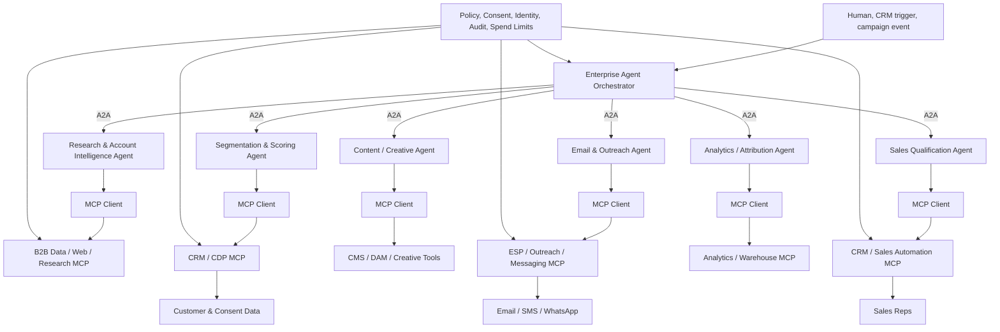

# Agentic Interoperability for Enterprise Marketing: MCP, Agent-to-Agent Systems, and the Emerging Multi-Agent Stack

## Executive Summary

As of **October 17, 2026**, enterprise artificial intelligence is transitioning from isolated conversational interfaces toward a highly interoperable architecture in which foundation models, specialized agents, business applications, and data ecosystems communicate via standardized protocols. A critical taxonomic correction is required for technical precision: **MCP formally designates the Model Context Protocol, not a “multi-agent communication protocol.”** MCP primarily standardizes the mechanisms by which AI applications access **external tools, data, resources, and workflows**. Conversely, direct **agent-to-agent** collaboration is explicitly governed by the **Agent2Agent protocol (A2A)** and related standardization initiatives. Consequently, these protocols must be understood as complementary architectural layers rather than competitive substitutes: **MCP connects agents to functional capabilities, whereas A2A connects agents to one another.** [1]

MCP has undergone substantial structural evolution since its introduction by Anthropic in November 2024. Protocol governance was transitioned to the Linux Foundation's Agentic AI Foundation in December 2025, supported by consortia including Anthropic, OpenAI, AWS, Google, Microsoft, Cloudflare, and Bloomberg. The landmark **July 28, 2026 MCP specification** deprecated stateful protocol-level sessions and the initialization handshake in favor of a stateless, HTTP-native core. This revision introduced Multi Round-Trip Requests, cacheable discovery mechanisms, authorization hardening, a formalized extension system, asynchronous Tasks, and MCP Apps. The subsequent August 2026 roadmap prioritizes **agentic messaging, HTTP transport hardening, agent identity frameworks, enterprise authorization models, and richer operational primitives**. As of the research cutoff date, no subsequent comprehensive MCP specification release was documented in the project's official archive. [2]

Concurrently, A2A has matured from Google's initial April 2025 proposal into a formalized Linux Foundation project. By April 2026, the foundation reported adoption and support from **more than 150 organizations**, alongside production-grade deployments across multiple industries and integrations within major cloud ecosystems. The stable A2A 1.0 architecture specifies **Agent Cards for capability discovery, Tasks for stateful workflow execution, Messages and Artifacts for data exchange, versatile transport bindings, streaming capabilities, asynchronous updates, security metadata, and modality-agnostic payloads**. Crucially, A2A is designed to allow agents to remain structurally opaque: collaborating agents are not required to disclose their internal prompt engineering, memory state, reasoning architectures, or underlying tool stacks. [3], [9]

For marketing, sales, and revenue operations, this decoupling engenders a highly robust system architecture. An orchestrator agent managing a campaign can delegate account research to a specialist agent via A2A; that subordinate research agent may subsequently query business intelligence databases or prospecting utilities via MCP. Similarly, a personalization agent can retrieve CRM historical data, an email execution agent can stage campaigns within an Email Service Provider (ESP), and an analytics agent can write attribution metrics back to the CRM. Human-in-the-loop (HITL) approval frameworks and policy-enforcement services can reside at an abstraction layer above both protocols. Contemporary academic literature corroborates this topology, characterizing MCP and A2A as foundational, complementary pillars for enterprise multi-agent orchestration, though it must be noted that much of this literature currently exists as preprint research rather than longitudinal empirical evidence. [4]

Within the specialized marketing provider ecosystem, **Dureach** occupies a distinctive position by synthesizing an MCP interface with native B2B data assets, research capabilities, contact enrichment, outbound orchestration, CRM functionalities, email infrastructure, buying signals, and embedded AI agents, rather than functioning merely as a generalized API bridge. Dureach documents that users may connect a preferred MCP client via OAuth to selectively expose integrated tools, while the platform autonomously aggregates disparate sources such as corporate databases, trade records, web telemetry, localized files, CRM interaction histories, communication replies, and public business signals. Publicly disclosed pricing initiates at **$29/month**, scales to $249/month for the Scale tier, and begins at **$1,500/month for Enterprise** deployments, wherein governance, API throughput, data-rights, customized volume, security, and Service Level Agreement (SLA) terms undergo bespoke negotiation. [5]

Dureach's proximal alternatives in the marketplace do not all serve as direct structural substitutes. The **Salesforce Marketing Cloud Engagement MCP** represents the most robust first-party enterprise marketing-suite interface within this comparative analysis; **HubSpot Remote MCP** excels specifically for CRM-native go-to-market (GTM) workflows; **Zapier MCP** provides exceptionally comprehensive no-code application connectivity; **Composio** functions as an agent-development and execution layer prioritizing managed authentication and scalable tool infrastructure; and **Pipedream** delivers a developer-centric API/MCP integration fabric featuring thousands of API connections and a distinct Conduit architecture tailored for secure, private enterprise deployments. Consequently, procurement strategies must be dictated by the required architectural role, rather than relying upon an arbitrary metric such as the “number of MCP tools” supported. [6]

The most compelling business evidence accumulated to date indicates that agentic systems can yield material improvements in marketing and sales operations; however, this evidence is **not yet methodologically equivalent to independent causal research isolating the effects of MCP**. Observational data from HubSpot indicates that customers utilizing its Prospecting Agent secured 80% more meetings compared to baseline cohorts; Salesforce reports that Uber achieved approximately 60% higher conversion rates and 50% higher response rates leveraging agentic outreach workflows; Zapier indicates that Vendavo accelerated lead-response times by 90%; and Salesforce outlines an Uber advertising application projected to process ad-sales Requests for Proposals (RFPs) 83% faster. While these represent highly encouraging operational signals, they predominantly comprise vendor-authored case studies of agentic applications rather than rigorously controlled experiments measuring the isolated contribution of the MCP or A2A protocols. [7]

The central conclusion of this analysis is therefore architecturally grounded rather than driven by product marketing: **MCP is structurally establishing itself as the standard enterprise tool and data interoperability layer, while A2A is solidifying its position as the credible inter-agent coordination layer.** In the domain of B2B marketing, the highest-yield near-term applications include account research, data enrichment, lead qualification, CRM synchronization, campaign operations, email staging, sales follow-up, analytics reporting, and agency workflow automation. Conversely, fully autonomous media purchasing across heterogeneous Demand Side Platforms (DSPs) remains significantly less mature; operational parameters such as bidding algorithms, budget authorization, brand safety, consent management, attribution modeling, and financial auditing necessitate stringent domain semantics and governance frameworks that generic tool invocation protocols cannot presently satisfy natively. [8]
## Protocol Landscape and Recent Technical Development

The emerging agentic protocol stack is most accurately conceptualized as a layered systems architecture. MCP, A2A, the converging Agent Communication Protocol (ACP), and the Agent Network Protocol (ANP) resolve distinct dimensions of system interoperability, precluding their categorization as directly equivalent competitors.

| Protocol | Primary abstraction | Architecture and transport | Discovery / state | Enterprise significance as of Oct. 2026 |
| --- | --- | --- | --- | --- |
| **MCP — Model Context Protocol** | Agent/model ↔ tools, data, resources, prompts | JSON-RPC-based; 2026-07-28 core is stateless and HTTP-native; optional extensions include Tasks, Skills over MCP, and MCP Apps | `server/discover`, tool/resource discovery; application state can exist outside the protocol; asynchronous Tasks extension | Most mature general-purpose **tool interoperability** layer; strong fit for CRM, ESP, data, analytics, automation, and SaaS APIs. [1] |
| **A2A — Agent2Agent** | Independent agent ↔ independent agent | Canonical data model with JSON-RPC, gRPC and HTTP/REST bindings; streaming and push notification support | Agent Cards advertise identity/capabilities; Tasks have stateful lifecycle; Messages/Artifacts exchange results | Most prominent open standard for **cross-vendor agent delegation and collaboration**; 150+ supporting organizations reported by Linux Foundation in 2026. [9] |
| **ACP — Agent Communication Protocol** | Agent ↔ agent | Lightweight REST/HTTP; synchronous/asynchronous operation and multimodal messages | Metadata-based discovery; designed for framework-independent agents | Historically important IBM/BeeAI effort, but **ACP has now been folded into A2A** and active ACP development is winding down; new deployments should therefore evaluate A2A migration rather than treat ACP as an independent long-term standard. [10] |
| **ANP — Agent Network Protocol** | Decentralized agent networks | HTTP/TLS foundation plus decentralized identity, discovery, encrypted messaging and domain protocols | DID-based identity and distributed discovery; human-readable WNS handles; federated messaging | More ambitious decentralized “agentic web” approach; relevant where cross-domain identity, federation, payments, and decentralized discovery matter, but enterprise adoption is less established than MCP/A2A. [11] |

The historical progression of these standards reveals significant paradigm shifts. MCP initially served as a bespoke mechanism to eliminate custom model-to-data integrations. By 2026, its architectural foundation had evolved to mirror conventional, scalable web infrastructure. The July revision systematically excised stateful protocol sessions, rendering each request self-contained and thereby allowing servers to operate efficiently behind standard round-robin load balancers. This update concurrently introduced per-request protocol and capability metadata, header-based routing, list-result caching, and Multi Round-Trip Requests—a paradigm allowing a server-side workflow to pause and request additional user input or confirmation prior to executing a consequential action. [2]

These protocol enhancements have direct implications for marketing operations. Earlier integrations frequently required bespoke adapters and persistent session management for individual applications. A stateless remote MCP server circumvents this friction, exposing discrete functions—such as `find_contact`, `update_deal`, `create_email`, `retrieve_campaign_stats`, or `launch_workflow`—behind standardized discovery and invocation schemas. An enterprise API gateway can subsequently scale these invocations horizontally while enforcing stringent authorization and audit protocols. Functionally, MCP is transitioning from an experimental "LLM plug-in interface" into core infrastructure capable of operating as an enterprise API tier. This conclusion represents an analytical inference derived directly from the protocol's stateless architectural redesign and prevailing vendor implementations. [12]

It is imperative to note that the protocol itself does **not** provide reasoning capabilities, underlying LLMs, Retrieval-Augmented Generation (RAG) indices, long-term state memory, or autonomous planning algorithms. Those sophisticated capabilities exclusively reside within the **agent host or orchestration layer**. For example, an application built on the OpenAI Agents SDK is responsible for synthesizing model reasoning, tool sets, execution handoffs, contextual state, operational tracing, safety guardrails, and MCP tool execution; comparable agent frameworks furnish analogous orchestration mechanics. MCP standardizes the boundary condition connecting the agent to external capabilities, rather than dictating the internal cognitive architecture of the agent. [13]

The A2A protocol governs the abstraction layer immediately superior to this mechanism. The protocol's `AgentCard` acts as a declarative manifest, informing external systems of an agent's capabilities and invocation methods; the `Task` primitive provides a robust, stateful operational object; `Message`, `Part`, and `Artifact` objects facilitate the exchange of text, files, and structured payloads; while streaming capabilities and webhook-style push updates accommodate long-running, asynchronous operations. Critically, the specification supports text, structured arrays, file references, and diverse modalities without mandating a uniform internal agent framework. [9]

This architectural dichotomy gives rise to a vital emerging design pattern within enterprise systems:

This structural topology captures the emerging division of labor identified by protocol maintainers and the latest multi-agent academic research: **A2A provides the substrate for horizontal collaboration among specialized, independent agents; MCP provides the protocol for vertical access from those agents into operational data systems.** Recent scholarship analyzing enterprise-orchestration proposes the integration of an additional control plane governing planning, policy enforcement, memory/state retention, and quality assurance, explicitly arguing against permitting an unrestricted mesh of agents to interact without centralized safeguards. [4]

The current MCP roadmap suggests this rigorous separation of concerns may become somewhat porous over time. The maintainers are prioritizing the development of **agentic messaging primitives**, explicitly focusing on the enhanced composition of Tasks, event subscriptions, progress telemetries, and server-initiated notification mechanisms. While this does not render MCP functionally identical to A2A, it expands MCP's utility beyond purely synchronous, procedural tool calls. The probable long-term equilibrium will feature overlapping yet complementary protocol domains rather than a perfectly demarcated operational stack. [14]

The broader standardization ecosystem is already undergoing active consolidation. ACP, which historically advanced IBM's REST-centric methodology for agent communication, is currently being merged into the A2A standard under Linux Foundation oversight. MCP itself migrated to the Linux Foundation's Agentic AI Foundation in December 2025. While these institutional alignments mitigate one form of protocol fragmentation, the challenge of *semantic* interoperability remains fundamentally unresolved: two agents may flawlessly share a transport protocol while retaining deeply incompatible definitions of what constitutes an “account,” “qualified lead,” “campaign,” “consent,” “conversion,” or “audience.” [10]
## Enterprise Agent Architecture and Capability Model

Conducting a rigorous evaluation of MCP providers necessitates drawing a sharp distinction between **protocol capability** and **agent capability**. Commercial claims emphasizing “support for GPT/Claude/Gemini,” “built-in memory,” or “multimodal compatibility” can obscure underlying architectures, as the MCP server rarely executes the reasoning model directly. The server’s role is to publish accessible tools; it is the client/agent host that dictates the foundational model, controls context retrieval, maintains memory state, and orchestrates complex call logic. Salesforce's technical documentation makes this separation explicitly clear: the LLM performs the cognitive reasoning, the client application manages the user interaction and authentication flows, and the MCP server serves merely to translate approved agent actions into corresponding Marketing Cloud Engagement API operations. [15]

The resultant enterprise stack can be analytically decomposed into seven discrete technical strata:

| Layer | Function in a marketing agent system | Typical technologies |
| --- | --- | --- |
| **Foundation/model layer** | Reasoning, generation, classification, vision/audio when required | Frontier and enterprise LLMs; multimodal models; smaller task-specific models |
| **Grounding layer** | Provides current customer, campaign, product and market context | RAG, search, vector/relational stores, CRM/CDP context, web/business research |
| **Agent runtime** | Planning, tool selection, execution loop, retries, handoffs | Agent frameworks, vendor agent platforms, custom orchestration |
| **Memory/state** | Conversation state, account state, campaign state, historical actions | Agent sessions, CRM/CDP, databases, workflow state stores |
| **Agent interoperability** | Delegation and cross-agent collaboration | A2A; increasingly agentic messaging extensions |
| **Tool interoperability** | Standard access to business capabilities | MCP servers/gateways; conventional APIs behind MCP |
| **Governance/observability** | Identity, permissions, approvals, logging, evaluation, policy | OAuth/OIDC, RBAC/ABAC, audit logs, human approval, SIEM, eval frameworks |

Emergent research evaluating enterprise multi-agent orchestration posits that planning routines, policy enforcement mechanisms, shared state arrays, and quality-control loops should be architected as a distinct coordination plane. A recent research paper by Capital One examining enterprise multi-agent deployments similarly underscores that multi-agent precision must be continuously evaluated against runtime latency and computational overhead. The proposed architecture in their study yielded a reported **4.48× throughput speedup** during testing while preserving task fidelity, empirically illustrating that orchestration architecture exerts an economic influence comparable to the raw quality of the underlying model. Such figures, however, represent specific research benchmarks rather than universal performance guarantees. [4]

Operational scale introduces a significant **tool-discovery bottleneck**. Injecting hundreds or thousands of complex tool schemas directly into an LLM’s prompt window can rapidly exhaust context limits and degrade the model’s tool-selection accuracy. Anthropic has published findings indicating that relying on code execution logic to interface with MCP tools—rather than continually injecting massive tool schemas and payload results back into the LLM—can drastically mitigate context consumption in appropriate workflows. Their published examples demonstrated context-reduction efficiencies of up to 98.7%. While this specific efficiency metric is highly sensitive to the architectural design and the nature of the workload, the underlying operational principle is critical for marketing ecosystems containing vast arrays of SaaS actions: dynamic tool retrieval, namespace partitioning, schema compression, and late-binding architectures must be prioritized as first-class engineering mandates. [16]

Consequently, the comparative capability of service providers diverges significantly when the responsibilities of the model-host and the tool-server are properly demarcated:

| Provider | Model/LLM support | Retrieval / grounding | Tool execution | Memory/state | Multi-agent/orchestration | Multimodality | Deployment |
| --- | --- | --- | --- | --- | --- | --- | --- |
| **Dureach** | MCP makes the external interface client/model-agnostic; Dureach does not publicly document a fixed underlying foundation-model architecture in the reviewed material. [5] | Strong native B2B grounding: companies, contacts, shipment/trade signals, websites, files, CRM history, replies, Deep Research and source provenance. [5] | Native prospect research, enrichment, outreach preparation, CRM work, marketing automation and messaging workflows exposed through product/agent interfaces and selectively through MCP. [5] | CRM records, saved research and operational workspace context; no public technical description of a general-purpose vector-memory architecture was identified. | Built-in AI agents and repeatable agent tasks; external agent clients can connect through MCP. Public A2A support was not identified in reviewed documentation. [5] | Can analyze PDFs, websites and transcripts; public docs do not establish a broad native image/video multimodal model architecture. [5] | Public service is cloud/SaaS-oriented; no general public on-prem/edge deployment offering was identified. |
| **Salesforce MCE MCP** | Designed for virtually any MCP-compatible agent/client; Salesforce explicitly names Claude, ChatGPT, Cursor and Gemini. [6] | Marketing Cloud data, content, journey and automation context; broader Salesforce grounding depends on the surrounding Salesforce architecture. | First-party near-1:1 wrapping of MCE APIs: data extensions, journeys, automations and related operations. [6] | MCP server itself is not permanent storage; state remains in Marketing Cloud and the agent/client. [15] | Orchestration supplied by the chosen agent host or Salesforce's broader agent stack, not by MCP alone. | Model/client dependent rather than intrinsic to MCE MCP. | Salesforce-hosted, with US/EU MCP endpoints documented. [17] |
| **HubSpot Remote MCP** | Any OAuth/PKCE-capable MCP client; HubSpot provides first-party connectors for ChatGPT, Claude, Copilot and Gemini. [18] | Very strong CRM grounding across contacts, companies, deals, tickets, activity history, segments and selected marketing/content objects. [19] | Read/write CRM operations, meeting/activity updates, task creation and other account actions according to permissions. [20] | Durable business state resides in HubSpot CRM; agent conversational memory remains host-dependent. | External orchestration plus HubSpot's own Breeze/Agent Hub capabilities; MCP itself is an access layer. | Host-dependent. | Remote HubSpot-hosted MCP for CRM; separate local Developer MCP exists for development workflows. [18] |
| **Zapier MCP** | Claude, ChatGPT and other MCP-compatible assistants; BYOM controls are documented for enterprise governance. [21] | Retrieves context through connected applications rather than providing a native RAG datastore. | Access to 9,000+ app connections and tens of thousands of actions; tool calls consume Zapier tasks. [22] | Zapier Tables/workflows can hold application state, but MCP does not create general agent memory. | Strong workflow orchestration through Zaps; MCP supplies the AI-action surface. [23] | Depends on model and connected apps. | Managed cloud service. |
| **Composio** | Model/framework agnostic through MCP and SDKs; intended as a tool/auth execution infrastructure for agents. [24] | Tool search/session context rather than a marketing-native RAG corpus. | Large tool/catalog layer with managed OAuth, execution, custom MCP ingestion and session-bound tool access. [25] | Session context and connected-account state; application retains responsibility for higher-level durable memory. | Designed to plug into external agent frameworks/orchestrators. | Tool/model dependent; not inherently limited to text. | Hosted cloud plus enterprise/self-managed credential and deployment options; deployment controls vary by plan. [25] |
| **Pipedream MCP / Conduit** | Compatible with common LLM/agent frameworks and MCP clients. [26] | API/tool-derived context rather than native marketing RAG. | 3,000+ integrated applications/APIs and 10,000+ prebuilt tools. [26] | State usually belongs to the workflow, API or surrounding application. | Developer-defined workflows/agent orchestration; Conduit can aggregate controlled tools for enterprise clients. [27] | Model/tool dependent. | Hosted MCP/Connect; Conduit provides a more controllable private enterprise gateway architecture, including network-access controls. [28] |

A critical architectural corollary derived from this analysis is that **RAG arrays and MCP interfaces operate as structural complements.** A RAG pipeline governs the curation and retrieval of semantic data injected into the model's reasoning context; MCP standardizes the protocol through which an agent dynamically interfaces with external datasets or functional endpoints. While a specific MCP tool configured for CRM searches might internally utilize semantic retrieval techniques, the overarching architecture allows the agent to utilize MCP strictly to fetch records while executing its own localized retrieval mechanisms. Treating “MCP compatibility” as functionally synonymous with “RAG integration” fundamentally conflates distinct architectural strata. The most recent comprehensive survey on agent interoperability explicitly echoes this distinction, separating intrinsic retrieval and actuation logic from protocol-layer interoperability standards. [29]

A secondary corollary is that **system memory must be strictly bifurcated into conversational context and durable business state.** While the agent host maintains the immediate continuity of a session, authoritative enterprise data must remain exclusively within the CRM, CDP, operational campaign engine, or formally governed datastores. This imperative is exceptionally critical within the marketing domain, where variables such as compliance consent, opt-out suppression lists, specific opportunity stages, and campaign affiliations must remain definitively authoritative and legally auditable, rather than probabilistically reconstructed from an LLM’s localized conversational history. This recommendation is structurally aligned with the design philosophies underpinning Salesforce's stateless MCP API architecture, HubSpot's CRM-centric remote server integration, and the intrinsic separation between protocol logic and application state codified within the MCP specification itself. [15]
